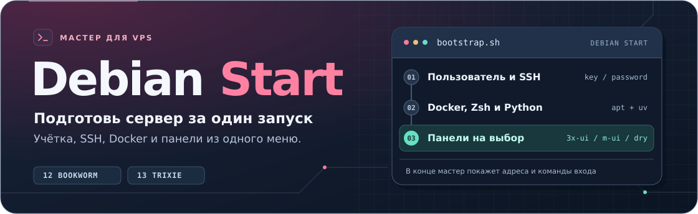

<div align="center">
  
</div>

<p align="center">
  <a href="#быстрый-старт"></a>
  <a href="#как-проходит-установка"></a>
  <a href="#компоненты"></a>
</p>

<p align="center">
  <strong>Интерактивная настройка нового Debian-сервера</strong><br>
  <a href="#быстрый-старт">Быстрый старт</a> ·
  <a href="docs/first-run.md">Инструкция для первого VPS</a> ·
  <a href="#компоненты">Компоненты</a> ·
  <a href="#структура-проекта">Структура проекта</a>
</p>

## Быстрый старт

Подключись к серверу по SSH и выполняй команды в открывшемся окне сервера. Если делаешь это впервые, начни с [пошаговой инструкции](docs/first-run.md).

### Если вошёл как `root`

```bash
apt-get update
apt-get install -y git
git clone https://github.com/dfyzicka/debianstart.git
cd debianstart
bash bootstrap.sh
```

<details>
<summary><strong>Если вошёл под пользователем с правами sudo</strong></summary>

```bash
sudo apt-get update
sudo apt-get install -y git
git clone https://github.com/dfyzicka/debianstart.git
cd debianstart
sudo bash bootstrap.sh
```

</details>

Если Git уже установлен, начни со строки `git clone`. Для установки из ZIP используй [раздел про архив](docs/first-run.md#02-загрузи-архив-и-запусти-мастер).

**Поддержка** · Debian 12 Bookworm и Debian 13 Trixie с systemd. Архитектуры amd64 и arm64. Модуль m-ui в Docker доступен на amd64.

## Как проходит установка

| Шаг | Что будет на экране |
| --- | --- |
| **01 · Доступ** | Имя сервера, логин Linux, SSH-ключ или пароль, адрес и порт для подключения. |
| **02 · План** | Что установится на сервере. 3x-ui, m-ui и dry выбираются отдельными галочками. |
| **03 · Первый вход** | Команда SSH, ссылки на панели, логины и пароли для первого входа. |

Мастер ставит Docker Compose, Zsh с Oh My Zsh и Powerlevel10k, fzf, скины Midnight Commander и пользовательский Python. Перед установкой можно вернуться к настройкам через кнопку **«Изменить»**.

### Способ входа по SSH

| Выбор | Что подготовить |
| --- | --- |
| **Свой ключ** | Вставь содержимое публичного файла `.pub`. |
| **Новый Ed25519** | Задай парольную фразу. Мастер покажет команду SCP для скачивания ключа через прежнюю учётку. Удали временную копию после проверки нового входа. |
| **Пароль** | Задай пароль Linux от 12 символов. Мастер применит парольный вход для выбранной учётки. |

Пароль Linux новой учётки также понадобится для `sudo`. Держи исходное SSH-окно открытым до проверки входа в другом окне. Скачанный приватный ключ храни в своём профиле. На Linux и macOS выставь ему права `chmod 600`.

## Компоненты

| Галочка | Для чего | Где смотреть |
| --- | --- | --- |
| **3x-ui** | Панель Xray. | `/opt/3x-ui`, SSH-туннель, порт от 2053. |
| **m-ui** | Панель Mihomo для Mieru и Sudoku. | `/opt/m-ui`, SSH-туннель, порт от 2054. |
| **dry** | Управление контейнерами в терминале. | Запуск командой `sudo dry`. |

Мастер выбирает свободные порты. Для входа в панель выполни команду SSH-туннеля на компьютере и открой показанный URL в браузере. Сохрани реквизиты перед нажатием **«Данные сохранены»**. До этого они доступны root в `install.state` соответствующей панели.

3x-ui использует образ `ghcr.io/mhsanaei/3x-ui:v3.11.0`. m-ui собирается через Docker из исходников RomanovCaesar. Для Mieru или Sudoku добавь вход нужного типа в разделе **Inbounds** и разреши клиентский порт в firewall и security group VPS.

<details>
<summary><strong>Пакеты Debian и версии утилит</strong></summary>

| Назначение | Debian 12 | Debian 13 |
| --- | --- | --- |
| Список файлов, алиас `sl` | `exa` | `eza` |
| Сведения о системе | `neofetch` | `fastfetch` |
| Справка `tldr` | `tealdeer` | `tealdeer` |
| fzf для Zsh | Скрипты из APT-пакета | `fzf --zsh` |

`python3-full` и `python3-pip` обслуживаются Debian. Python 3.15.2 ставится через `uv` в профиль пользователя. В Zsh команда `python3 --version` покажет 3.15.2, а `/usr/bin/python3` запускает системный интерпретатор.

Мастер скачивает dry v0.13.0 для архитектуры сервера, сверяет SHA-256 с метаданными релиза и устанавливает бинарник в `/usr/local/bin`.

</details>

## Структура проекта

| Путь | Содержимое |
| --- | --- |
| [`bootstrap.sh`](bootstrap.sh) | Запуск мастера из корня. |
| [`installer/lib/`](installer/lib/) | Настройка системы, SSH, Docker и панелей. |
| [`installer/compose/`](installer/compose/) | Шаблоны Compose. |
| [`installer/profile/`](installer/profile/) | Настройки Zsh и Nano, тема и скины MC. |
| [`docs/`](docs/) | Руководство и графика README. |
| [`tests/`](tests/) | Локальные проверки. |
| [`.github/workflows/`](.github/workflows/) | Проверки в GitHub Actions. |
| [`licenses/`](licenses/) | Лицензии сторонних тем. |

## Диагностика

Журнал установки находится в `/var/log/debian-start.log`. Если мастер остановился, проверь последний этап и после устранения причины запусти его снова. Повторный запуск переиспользует каталоги данных панелей и настроенный профиль оболочки.

```bash
sudo tail -n 50 /var/log/debian-start.log
```

Для проверки контейнера перейди в каталог выбранной панели. Ниже пример для 3x-ui.

```bash
cd /opt/3x-ui
sudo docker compose --env-file compose.env ps
sudo docker compose --env-file compose.env logs --tail=50
```

Под `root` выполняй эти команды без `sudo`. Мастеру нужен доступ к APT, GitHub, PyPI и реестрам Docker.

## Проверки и оформление

Запусти `bash tests/check.sh`, чтобы проверить скрипты, выбор компонентов и состояние первого входа. GitHub Actions также проверяет файлы Compose.

- Конфигурация приглашения основана на Powerlevel10k. [Проект](https://github.com/romkatv/powerlevel10k)
- Dracula и Dracula256 для Midnight Commander входят в проект. [Темы](https://draculatheme.com/midnight-commander)
- Скин Ajnasz Blue скачивается при настройке профиля. [Страница автора](https://ajnasz.hu/blog/20140228/midnight-commander-skin)

Для значков Powerlevel10k выбери Nerd Font в настройках терминала на компьютере.
